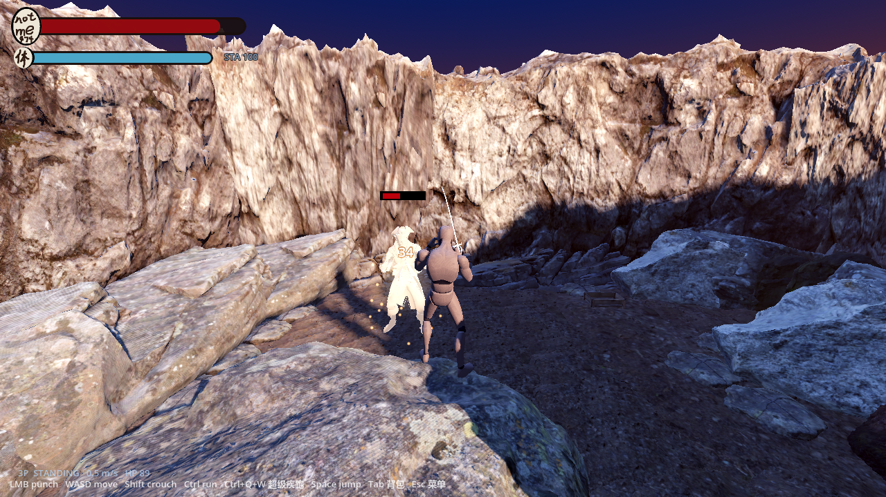

[README.md](https://github.com/user-attachments/files/35027628/README.md)
# BigGame

Copyright (c) 2025 [notme474]. All rights reserved.

## 游戏介绍

一款第三人称动作小游戏。你在一座荒废的峡谷里醒来，握着一把剑，穿过石阵走向峡谷深处——那里有个守着石碑和门的石头守卫，他不打算让你过去。

- 第三人称 / 第一人称随时切换（V 键）
- 剑斗：轻击、疾跑、耐力条，被打会踉跄
- 背包：5×7 格子 + 武器 / 防具 / 戒指装备栏
- Boss 战：五种招式、可绕背、破防后处决窗口
- 暂停菜单与单存档（保存 / 读取）

## 操作

| 按键 | 功能 |
|---|---|
| W A S D | 移动 |
| 鼠标 | 转视角 |
| 鼠标左键 | 攻击 |
| 鼠标滚轮 | 拉近 / 拉远镜头 |
| Space | 跳跃 |
| Shift | 蹲伏 |
| Ctrl | 奔跑 |
| Ctrl + Q | 超级疾跑（消耗耐力） |
| V | 切换第一 / 第三人称 |
| Tab / B / I | 打开背包 |
| Esc | 暂停菜单 |

## 运行环境

- Windows 10 / 11 64 位
- 支持 OpenGL 3.3 及以上的显卡
- 免安装：解压后直接双击 `3at.exe`

## 下载游玩

请前往右侧的 [Releases](../../releases) 页面下载最新版本的游戏文件。

## 版权与授权说明

1. 本游戏发布的二进制文件（可执行文件）仅供**个人、非商业性游玩**。
2. **未经作者书面授权，严禁任何形式的商业利用**，包括但不限于：二次打包、植入广告、付费分发、或将本游戏用于任何盈利性项目。
3. 作者保留对游戏源码及游戏本体的所有权利。
